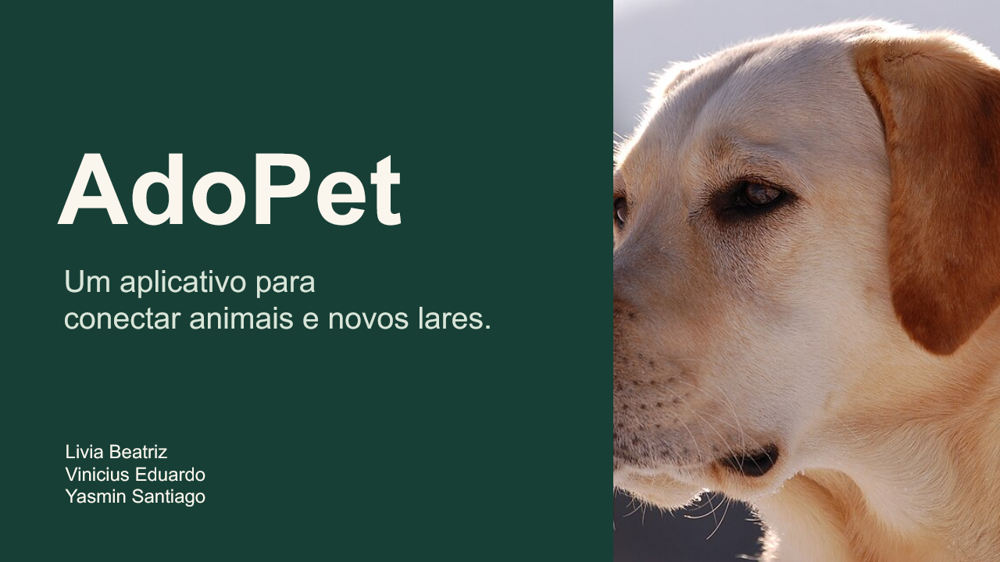

# AdoPet

Aplicativo Android para divulgar animais e registrar interesse em adoção.
Desenvolvido em Kotlin, com armazenamento local em SQLite.

**Integrantes:** Livia Beatriz, Vinicius Eduardo e Yasmin Santiago.

## Funcionalidades

- Catálogo com filtros por espécie, porte, sexo e disponibilidade.
- Detalhes e fotografias ilustrativas dos animais.
- Cadastro, edição e exclusão dos próprios animais pelo responsável.
- Campo para informar outra espécie, como Coelho ou Calopsita.
- Cadastro de conta e login local com perfis de adotante e responsável.
- Formulário de pré-adoção e consulta dos interessados pelo responsável.
- Validações e bloqueio de interesses duplicados.
- Persistência dos dados após fechar o aplicativo.

## Como executar

1. Clone ou baixe este repositório.
2. Abra a pasta **android** no Android Studio.
3. Aguarde a sincronização do Gradle.
4. Selecione um emulador ou celular e clique em **Run**.

O projeto utiliza SDK 35 e JDK 17 ou superior. O Android Studio pode precisar
de internet na primeira sincronização para baixar ferramentas e dependências.
Depois de instalado, o aplicativo funciona offline. Não exige servidor.

Para instalar diretamente em um Android 7.0 ou superior, use [AdoPet.apk](AdoPet.apk).
Este APK é uma compilação de demonstração.

## Conta de demonstração

E-mail: `responsavel@adopet.local`  
Senha: `Adopet@2026`

Conta fictícia local para apresentação. Ela gerencia Luna e Nina.
Mingau e Thor são exemplos de outros responsáveis, disponíveis para consulta.
Também é possível criar uma nova conta local e cadastrar seus próprios animais.

## Organização

| Pasta ou arquivo | Conteúdo |
| --- | --- |
| android | Projeto Android Studio, código Kotlin e layouts XML |
| android/app/src/main/java/com/adopet/app/DatabaseHelper.kt | Banco, validações, contas e operações |
| android/app/src/androidTest | Testes de instrumentação em bancos separados |
| apresentacao | Slides, PDF, guia de estudo e roteiro |
| AdoPet.apk | Aplicativo compilado para demonstração |

O banco `adopet.db` contém as tabelas `users`, `animals` e `interests`.
Os IDs relacionam cada animal ao responsável e cada interesse ao animal.
SharedPreferences guarda a sessão local e as opções de filtro.

## Testes e limites

Os testes executados no emulador verificaram CRUD, filtros, persistência,
login, perfis, propriedade dos animais, validações, duplicidade, histórico e migração.
Detalhes em [TESTES.md](android/TESTES.md).

Cada instalação tem seus próprios registros. Não há sincronização entre aparelhos,
envio automático à ONG ou recuperação de senha. Limpar os dados ou desinstalar
remove o banco local. O interesse não conclui a adoção.

## Apresentação

- [PowerPoint editável](apresentacao/AdoPet-Apresentacao.pptx)
- [Slides em PDF](apresentacao/AdoPet-Apresentacao.pdf)
- [Roteiro](apresentacao/ROTEIRO-APRESENTACAO.md)
- [Guia das funcionalidades e persistência](apresentacao/GUIA-YASMIN.md)

## Imagens

As fotos são ilustrativas e têm seus créditos e licenças em
[CREDITOS-IMAGENS.md](android/CREDITOS-IMAGENS.md). O logotipo veio no material original do grupo.
